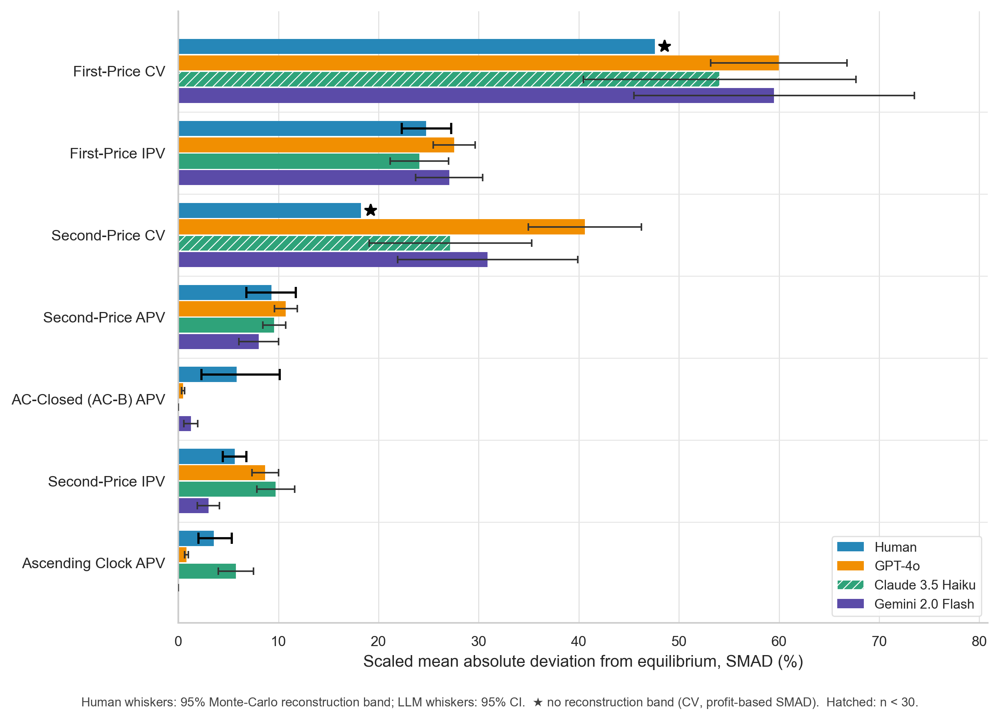

# LLM Bidders Preserve the Mechanism-Level Orderings of Human Bidders

[](https://opensource.org/licenses/MIT)

## Table of Contents

1. [Overview](#overview)
2. [Getting Started](#getting-started)
3. [Auction Parameters](#auction-parameters)
4. [Reproducing Our Results](#reproducing-our-results)

---

## Overview

This repository contains the auction simulator, recorded experiment data, and analysis for **LLM Bidders Preserve the Mechanism-Level Orderings of Human Bidders**. The September 2026 revision evaluates five models across seven laboratory auction settings, with additional tests of auction descriptions and eBay-style closing rules.

We compare three features of behavior: the magnitude and direction of deviations from theory, and the ordering of auction formats by those deviations. The main finding is that three non-reasoning large models preserve key orderings without task-specific fine-tuning or calibration to human bids, even though their error magnitudes and directions differ from those of human bidders. More accurate equilibrium play does not necessarily make a model a better simulator of human behavior.

<p align="center">
  
</p>

- [Current manuscript source](writeup/main.tex)
- [Data sources and provenance](data_map.md)
- [Earlier paper version](https://openreview.net/forum?id=XZ71GHf8aB)

The existing directory organization is retained: `src/` and `scripts/` contain the simulator, `configs/`, `Prompt/`, and `rule_template/` describe experiments, `experiment_logs/` and `robustness_logs/` contain recorded runs, `analysis/` and `scripts/plots/` contain analysis, and `results/` and `writeup/` contain outputs.

If you build on this work, please cite:

```bibtex
@unpublished{shah2026llmbidders,
  title  = {{LLM} Bidders Preserve the Mechanism-Level Orderings of Human Bidders},
  author = {Shah, Anand V. and Zhu, Kehang and Jiang, Yanchen and Wang, Jeffrey G.
            and Dayi, Arif K. and Horton, John J. and Parkes, David C.},
  year   = {2026},
  note   = {Working paper},
  url    = {https://github.com/KeHang-Zhu/llm-auction}
}
```

---

## Getting Started

### Offline analysis

Recorded results can be analyzed **without an API key or new model calls**. The pinned analysis environment was tested with Python 3.9.6.

```bash
git clone https://github.com/KeHang-Zhu/llm-auction.git
cd llm-auction
python3 -m venv .venv
source .venv/bin/activate
pip install -r requirements-analysis.txt
python scripts/reproduce_paper.py --check
```

The command regenerates the current analyses and figures, then compares the five principal CSV outputs with the checked-in results. It stops on a failed analysis or a numerical mismatch. Bootstrap analyses use seed 1299 and 2,000 draws; the data map documents their uncertainty assumptions.

### Running new auctions

Install the additional simulator dependencies and configure credentials for the provider used by your YAML configuration:

```bash
pip install -r requirements.txt
export OPENAI_API_KEY="YOUR_KEY_HERE"
python scripts/main.py --config configs/experiments/01_01_spsb_ipv.yaml
```

The simulator uses EDSL. New runs may incur provider charges; cache availability is not guaranteed. The published results should be reproduced from the recorded data above, since a new API run may use a different model version or return different sampled choices.

---

## Auction Parameters

The current entry point is `scripts/main.py --config PATH`. Auction rules, values, model settings, and repetition counts are specified in YAML, rather than as the legacy root-level script flags.

| Auction type | Example configuration | Main settings |
| --- | --- | --- |
| Second-price sealed bid | `configs/experiments/01_01_spsb_ipv.yaml` | `rule.seal_clock: seal`, `rule.price_order: second` |
| First-price sealed bid | `configs/experiments/01_03_fpsb_ipv.yaml` | `rule.price_order: first` |
| Ascending clock | `configs/clock/01_06_ascending_clock_apv.yaml` | `rule.seal_clock: clock`, `rule.ascend_descend: ascend` |
| Closed ascending clock | `configs/clock/01_07_ascending_clock_apv_closed.yaml` | `rule.open_blind: blind` |
| Common-value auction | `configs/experiments/01_08_common_value_first.yaml` | `rule.private_value: common` |
| Description intervention | `configs/experiments/03_02_intervention_proxy_breitmoser.yaml` | `rule.special_name` selects the description |
| eBay-style proxy auction | `configs/experiments/02_01_ebay_reserve_0.yaml` | `prompt.strategy_type: ebay`, closing rule and reserve settings |

These configurations are examples for generating new experiments. The published framing and closing-rule comparisons use the archived datasets identified in [data_map.md](data_map.md), not every historical configuration with a similar name.

```bash
# A small new first-price run
python scripts/main.py --config configs/experiments/01_03_fpsb_ipv.yaml --repetitions 5

# An ascending-clock run
python scripts/main.py --config configs/clock/01_06_ascending_clock_apv.yaml
```

See [configs/README.md](configs/README.md) for the configuration structure. Seed bases and exact model identifiers are recorded with each experiment; they are not uniform across all datasets.

---

## Reproducing Our Results

### 1. Models and settings

| Role | Recorded model identifier |
| --- | --- |
| Non-reasoning large model; reference for detailed diagnostics | `gpt-4o` |
| Non-reasoning large model | `claude-3-5-haiku-20241022` |
| Non-reasoning large model | `gemini-2.0-flash` |
| Reasoning comparison | `gpt-5-mini` |
| Small-model comparison | `meta-llama/Meta-Llama-3-8B-Instruct` |
| Additional clock-framing check | `google/gemma-3-27b-it` |

The main non-reasoning runs use temperature 0.5; the GPT-4o sensitivity analysis uses 0.1, 0.5, and 1.0. GPT-5-mini ignores temperature. Historical paths containing `claude_sonnet` actually contain **Claude 3.5 Haiku** observations, as identified by the recorded model field.

### 2. Analyses and outputs

Run all steps with `python scripts/reproduce_paper.py --check`, or run individual steps from the repository root:

| Analysis | Command | Principal output |
| --- | --- | --- |
| Human reconstruction uncertainty | `python analysis/reconstruction_bands.py` | `results/reconstruction_bands/bands.csv` |
| Model-by-format deviations | `python scripts/plots/model_comparison_main.py` | `results/analysis/model_smad_results.csv` |
| Main comparison figure | `python scripts/plots/figure1_bands_models.py gp` | `writeup/figures/figure1_bands_gp.png` |
| Error directions | `python scripts/plots/figure2_models.py` | `results/analysis/direction_shares_models.csv` |
| GPT-4o rank concordance | `python analysis/difficulty_concordance.py` | `results/analysis/difficulty_concordance.json` |
| Cross-model rank concordance | `python analysis/difficulty_concordance_models.py` | `results/analysis/difficulty_concordance_models.csv` |
| Temperature robustness | `python analysis/temperature_concordance.py` | `results/analysis/temperature_concordance.csv` |
| Description interventions | `python scripts/plots/interventions_models.py` | `results/analysis/interventions_models.csv` |
| eBay closing rules | `python scripts/plots/ebay_closing_rule_only.py` | `results/analysis/ebay_closing_rule_summary.csv` |
| Repeated-auction appendix | `python scripts/plots/appendix1_learning.py` | `writeup/figures/smad_rounds.png` |
| Original temperature appendix figure | `python scripts/plots/appendix2_temperature.py` | `writeup/figures/appendix2_temperature_comparison.png` |

The current manuscript uses `writeup/figures/` and `writeup/tables/`. The scorecard and human-band LaTeX tables are maintained summaries of the generated results. Other historical analysis scripts and notebooks remain available; the commands above are the supported reproduction path for the current revision.

### 3. Interpreting the data

Human benchmarks are reconstructions from published summary statistics, **not individual human participant records**. Their uncertainty bands describe reconstruction uncertainty. Private-value bid deviations and common-value profit deviations use different normalizers and are not pooled into one rank comparison. Clock analyses exclude winning bidders whose exit prices are censored; cells with fewer than 30 usable bids are flagged or excluded from rank comparisons. Missing clock observations are not zero-error observations. See [data_map.md](data_map.md) and the generated analysis reports for details.

### 4. Building the manuscript

With a LaTeX installation that provides the packages in `writeup/main.tex`:

```bash
cd writeup
pdflatex -interaction=nonstopmode -halt-on-error main.tex
bibtex main
pdflatex -interaction=nonstopmode -halt-on-error main.tex
pdflatex -interaction=nonstopmode -halt-on-error main.tex
```

---

## Dependencies

`requirements-analysis.txt` pins the tested offline analysis dependencies. `requirements.txt` lists the simulator dependencies, including EDSL and Jinja2, for generating new auctions. Offline reproduction does not import EDSL or require provider credentials.

## Contributing, Feature Requests, and Bugs

Please open an issue or contact kehangzhu@gmail.com.
